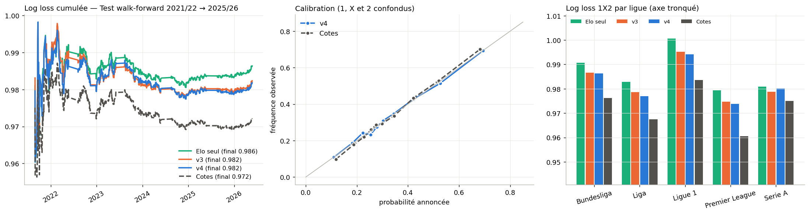

# Prédiction statistique des matchs de football — modèle v5

Projet académique. On construit un **modèle statistique transparent** qui donne, pour un match des 5 grands championnats européens :

- les probabilités **1 / X / 2** en pourcentage,
- les **buts attendus** et la grille des scores exacts,
- les marchés dérivés : over/under, les deux équipes marquent, cage inviolée, but en 1re mi-temps,
- les **corners** et les **cartons** (jaunes et rouges) attendus, avec leurs probabilités,
- une **cote juste** (1/p) et un **indice de fiabilité**,
- des **statistiques descriptives** par équipe (forme, buts, tirs, corners, cartons, confrontations directes),
- un **classement de tous les marchés d'un match, du moins risqué au plus risqué**, avec comparaison aux cotes,
- le **contexte** de chaque match (repos, promu, champion en titre, enjeu de fin de saison), des **statistiques attendues avec intervalles** et les **matchs comparables** de l'historique,
- les **coupes d'Europe** (Ligue des champions, Ligue Europa, Conference League) avec un modèle Elo dédié,
- un **degré de confiance A/B/C** vérifié sur des matchs que le modèle n'avait pas vus,
- une **application Streamlit** et une plateforme web (Goalgebra) **à jour chaque jour**, alimentées par des **sources réelles**
  (football-data.org, football-data.co.uk, openfootball), avec un **assistant statistique**.

## 🚀 Démarrage rapide (application en ligne)

```bash
pip install -r requirements.txt
streamlit run app.py
```

| Page | Contenu |
|---|---|
| **Sélection du jour** (accueil) | pour chaque match : sélection retenue, analyse prudente ou abstention ; probabilité calibrée, borne basse, référence, qualité des données, désaccord entre modèles, explication |
| **Matchs** | journée choisie (◀ ▶), analyse de la journée avec intervalles à 80 %, matchs par compétition, prédictions à la une |
| **Fiche match** | onglets Aperçu · Analyse IA · **xG & forme** · Cotes · H2H · Classement |
| **Prédictions IA** | toutes les prédictions à venir, triables, et l'historique hors échantillon |
| **Équipes** | profil complet : forme, xG créés/concédés, finition, Elo, profil centile, prochains et derniers matchs |
| **Compétitions** | statistiques de ligue et classements (phase de ligue des coupes incluse) |
| **Cotes & risque** | toutes les issues des prochains matchs, du moins risqué au plus risqué |
| **Assistant** | questions en français (« Analyse Arsenal – Chelsea », « Forme de Barcelona »…) ; Claude si `ANTHROPIC_API_KEY` |
| **Performance de l'IA** | suivi jour par jour, calibration, fiabilité des niveaux de confiance, coupes |
| **Méthode et limites** · **Laboratoire** | méthodologie, sources, limites ; entraînement et tests à la volée |

**Mise à jour automatique** : GitHub Actions recalcule `web/data` toutes les 2 heures (pipeline principal). En secours, si les
données ont plus de 6 heures, l'application relance elle-même le calcul en arrière-plan (bouton « 🔄 Mettre à jour » pour forcer).
Si une source publie les résultats en retard, un bandeau **« données en retard »** l'indique (dernier résultat connu, matchs joués sans score).
Une prédiction n'est publiée et figée au journal **qu'avant le coup d'envoi** ; un test automatique le vérifie.
Mise en ligne gratuite sur Streamlit Community Cloud et secrets facultatifs : [`docs/deploiement_streamlit.md`](docs/deploiement_streamlit.md).

Le modèle est évalué selon un **protocole sans fuite d'information** : il est testé sur des saisons qu'il n'a jamais vues, avec des scores probabilistes et des intervalles de confiance.

> ⚠️ Projet de recherche. Aucune stratégie de pari n'est proposée. Le notebook 05 montre, données à l'appui, que le modèle ne bat pas le marché.

---

## Résultats principaux (évaluation rétrospective walk-forward 2021/22 → 2025/26, 8 896 matchs communs)

Tous les modèles sont notés sur **exactement les mêmes 8 896 matchs** (mêmes variables d'entrée, matchs où les cotes existent),
avec `python scripts/comparaison_commune.py`. Chaque saison est prédite par un modèle entraîné sur les seules saisons précédentes.
La log loss est le critère principal (plus bas = mieux) ; le skill score est le gain par rapport aux simples fréquences.

| Modèle | Log loss | RPS | Brier | ECE (calibration) | Bon résultat | Skill score |
|---|---|---|---|---|---|---|
| Fréquences (aucune information) | 1,0736 | 0,2300 | 0,6497 | 0,010 | 43,5 % | 0 % |
| Elo seul | 0,9852 | 0,1998 | 0,5874 | 0,012 | 52,5 % | 8,2 % |
| v3 | 0,9816 | 0,1988 | 0,5849 | 0,013 | 53,0 % | 8,6 % |
| v4 | 0,9812 | 0,1987 | 0,5844 | 0,012 | 52,7 % | 8,6 % |
| **v5 (modèle en production)** | **0,9810** | **0,1987** | **0,5844** | **0,011** | 52,6 % | **8,6 %** |
| *Cotes des bookmakers (référence externe)* | *0,9710* | *0,1954* | *0,5775* | *0,015* | *53,7 %* | *9,6 %* |

| Comparaison (mêmes matchs) | Δ log loss ×10⁻³ | IC 95 % | Significatif |
|---|---|---|---|
| v5 − Elo seul | −4,20 | [−6,55 ; −1,78] | oui |
| v5 − v4 | −0,21 | [−1,07 ; +0,57] | non |
| v4 − v3 | −0,40 | [−1,55 ; +0,77] | non |
| v5 − Cotes | +9,98 | [+7,27 ; +12,81] | oui (les cotes restent meilleures) |

> **Statut de cette évaluation.** 2021-2026 a d'abord servi de test final pour v3/v4. Les variables de v5 (enjeu de fin de saison)
> ont ensuite été étudiées sur 2010-2025, période qui recoupe ce test : pour v5, 2021-2026 est donc une **évaluation rétrospective**,
> plus un test totalement intact. La seule évaluation **prospective** est le journal 2026/27 : chaque prédiction y est figée
> avant le coup d'envoi (page « Performance de l'IA »), et ces saisons n'ont servi à aucun choix de variables.

- **Le modèle bat nettement Elo seul**, et il est bien calibré : quand il annonce 40 %, l'issue se réalise environ 40 % du temps.
- **v3 → v4 → v5** : gains faibles et non significatifs sur le 1X2 ; v4 améliore significativement les marchés de buts
  (score exact, over 2,5 ; `docs/resultats.md` §2). v5 n'ajoute que l'enjeu de fin de saison, seul facteur de contexte à l'effet propre significatif (§11).
- **Modèle + cotes** : le poids optimal du modèle est ≈ 0, les cotes contiennent déjà son information.
- **Face aux cotes**, l'écart reste d'environ +10 ×10⁻³ (significatif). Le marché dispose d'informations absentes des données : compositions, blessures, vrais xG.

- **Paliers de risque** : sur 264 660 décisions testées, la probabilité annoncée correspond à la fréquence observée à moins de 0,3 point près dans chaque palier. Aux cotes réelles, aucun palier n'est rentable.
- **Corners et cartons** : les modèles battent la moyenne de la ligue (significatif), mais ces statistiques restent peu prévisibles.

Détails : [`docs/resultats.md`](docs/resultats.md). Graphiques : `results/figures/`.



---

## Structure du dépôt

```
├── footpred/                  ← le modèle, sous forme de package Python
│   ├── config.py              paramètres (ratings réglés sur 2006-2015, modèles choisis sur 2017-2021)
│   ├── data.py                chargement du dataset public
│   ├── ratings.py             pi-ratings + ratings de buts GAS (état conservé pour prédire)
│   ├── features.py            variables d'avant-match sans fuite, état des équipes
│   ├── contexte.py            repos, statut (promu, champion), enjeu au classement de la veille
│   ├── sources.py             sources réelles interchangeables (football-data.co.uk, fusion, Elo)
│   ├── openfootball.py        source de secours sans clé (calendrier complet + scores, GitHub)
│   ├── live.py                football-data.org (calendrier, scores en direct)
│   ├── coupes.py              coupes d'Europe : historique, Elo, modèle dédié
│   ├── confiance.py           degré de confiance A/B/C, calibration par marché, suivi quotidien
│   ├── web.py                 pipeline de publication (web/data/*.json)
│   ├── analyse.py             statistiques attendues, matchs comparables, modèle vs marché
│   ├── models.py              logit multinomial (1X2), Poisson + Dixon-Coles (buts)
│   ├── markets.py             marchés dérivés, cotes justes, méthode de Shin
│   ├── evaluation.py          log loss, RPS, Brier, ECE, bootstrap, walk-forward
│   ├── predict.py             Predicteur.simulation(dom, ext)
│   ├── journal.py             suivi en direct : journal horodaté + évaluation
│   ├── decision.py            classement des marchés par niveau de risque, comparaison aux cotes
│   ├── statistiques.py        statistiques descriptives : profils d'équipe, confrontations directes
│   ├── labo.py                laboratoire : validation, saison, semaine par semaine, stratégies, corners/cartons, paliers
│   └── __main__.py            ligne de commande
├── notebooks/
│   ├── 01_exploration_donnees.ipynb   analyse exploratoire du dataset
│   ├── 02_modele_final.ipynb          construction, formules, validation, simulation
│   ├── 03_labo_saison.ipynb           test sur une saison + semaine par semaine
│   ├── 04_suivi_hebdomadaire.ipynb    prédictions en direct et évaluation
│   ├── 05_efficience_marche.ipynb     expérience : le marché est-il battable ?
│   └── archives/                      versions v1 → v4 (historique du projet)
├── tests/                     tests automatiques (absence de fuite, probabilités, bout en bout)
├── web/                       plateforme web Next.js (Match Center, analyses, performance IA)
├── .github/workflows/         publication automatique des données (toutes les 2 h) et tests
├── app.py                     application Streamlit (point d'entrée)
├── appui/                     pages, composants visuels, données et mise à jour automatique, assistant, comptes
├── plateforme/                mode serveur : base de données, comptes, API publique (FastAPI), worker de calcul
├── deploy/                    Docker Compose, Caddy (HTTPS), script de sécurisation du serveur, modèle .env
├── Dockerfile                 image unique (application, API, worker)
├── .streamlit/config.toml     thème de l'application
├── scripts/reproduire.py      régénère tous les résultats du rapport
├── results/                   tables CSV, figures PNG, classeur Excel
├── journal/                   journal des prédictions en direct
├── docs/                      méthodologie, résultats, plan du rapport, guide, références
└── data/                      cache local du dataset (non versionné)
```

---

## Installation

```bash
git clone https://github.com/abdelkbir1243/projet-de-prediction-foot.git
cd projet-de-prediction-foot
pip install -r requirements.txt
```

**Dans Google Colab**, ouvrir n'importe quel notebook de `notebooks/` : la première cellule clone le dépôt et installe tout.

## Plateforme web Goalgebra (Next.js)

Une plateforme complète de Football Analytics inspirée des meilleures applications de scores, avec une identité originale :
- Match Center du jour ;
- pages de match avec analyse IA ;
- compétitions, classements, équipes et statistiques ;
- tableau de bord de transparence « Performance IA ».

Le pipeline `python -m footpred.web` publie les données toutes les 2 heures (GitHub Actions), et les scores en direct sont servis par `/api/live`.
Mode d'emploi : [`docs/plateforme_web.md`](docs/plateforme_web.md).

## Protocole scientifique (v5.4)

Banc d'essai chronologique : A = 2016-2020, B = 2021-2024 (validation), T = 2025/26 (test final réservé), puis suivi prospectif.
`python scripts/banc_generer.py && python scripts/banc_evaluer.py` régénère `docs/resultats_v6.md` et l'artefact du moteur de
sélection. Synthèse, défauts corrigés et limites : [`docs/audit_v6.md`](docs/audit_v6.md) ; fiches [`modèle`](docs/model_card.md)
et [`données`](docs/data_card.md).

## Plateforme sur ton propre serveur

Le même code tourne en **mode plateforme** sur un VPS : HTTPS (Caddy), comptes utilisateurs et équipes suivies, **API publique**
(FastAPI, clés et quotas, documentation `/docs`), PostgreSQL, worker de calcul toutes les 2 h, page **Administration**
(supervision des calculs, journal prospectif, comptes, consommation de l'API, audit), alertes et sauvegardes quotidiennes.

```bash
sudo bash deploy/installer_serveur.sh goalgebra        # sécurise le serveur (pare-feu, fail2ban, SSH par clé, Docker)
cp deploy/.env.example deploy/.env && nano deploy/.env
docker compose -f deploy/docker-compose.yml --env-file deploy/.env up -d --build
```

Guide complet : [`docs/deploiement_serveur.md`](docs/deploiement_serveur.md).

## Application Streamlit

Voir le **Démarrage rapide** en haut de page. L'ancienne application d'étude (prédire un match ou une journée en recalculant
le modèle) reste disponible dans le menu **Étude → Laboratoire du modèle**.

## Utilisation

**En Python / notebook**

```python
from footpred import preparer
pred = preparer()                                   # ≈ 30 s : données, ratings, modèle final
pred.simulation("Arsenal", "Chelsea")               # affichage complet
r = pred.simulation("Inter", "Milan", afficher=False)
print(r["1"], r["X"], r["2"], r["over25"])          # dictionnaire de probabilités
```

**En ligne de commande**

```bash
python -m footpred predire "Arsenal" "Chelsea" --cotes 1.80 3.90 4.50
python -m footpred journee "Arsenal vs Chelsea@2026-10-04" "Inter vs Milan"   # ajoute au journal
python -m footpred evaluer                                                    # note le journal
python -m footpred valider                                                    # test walk-forward 2021-2026
python scripts/reproduire.py --saison 2025                                    # tous les résultats du rapport
python -m pytest tests                                                        # tests automatiques
```

La routine hebdomadaire est décrite dans [`docs/guide_utilisation.md`](docs/guide_utilisation.md).

---

## Méthode en bref

1. **Données** : [xgabora/Club-Football-Match-Data-2000-2025](https://github.com/xgabora/Club-Football-Match-Data-2000-2025). Environ 230 000 matchs, dont les 5 grands championnats depuis 2005. On y trouve les résultats, les tirs, les corners, ClubElo et les cotes.
2. **Ratings** calculés match après match, sur toutes les ligues :
   - **ClubElo** ;
   - **pi-ratings** (Constantinou & Fenton 2013) ;
   - **ratings de buts GAS** (Koopman & Lit 2019), qui estiment la force d'attaque et de défense de chaque équipe.
3. **Variables** : écart d'Elo, |écart d'Elo|, qualité de jeu ΔQ (xG approché par les tirs cadrés), ouverture du match, pi, GAS, ligue et niveau de buts de la ligue.
4. **Modèles** :
   - 1X2 : logit multinomial ;
   - buts : Poisson + Dixon-Coles.
   Les deux sont pondérés dans le temps (demi-vie de 4 saisons).
5. **Protocole** :
   - réglage des ratings sur 2006-2015 ;
   - sélection du modèle sur 2017-2021 ;
   - **évaluation rétrospective walk-forward sur 2021-2026**, tous modèles sur les mêmes matchs (test intact pour v3/v4,
     rétrospectif pour v5 dont les variables ont été étudiées sur 2010-2025) ;
   - **évaluation prospective** à partir de 2026/27 : journal des prédictions figées avant chaque coup d'envoi.

Formules complètes : [`docs/methodologie.md`](docs/methodologie.md).

## Limites

- **Pas d'informations sur les compositions, les blessures ni les vrais xG** : c'est la principale source de l'écart avec les cotes.
- **Ajouter des variables n'aide plus.** Au-delà d'environ 40 variables, le modèle surapprend (voir `docs/resultats.md`).
- **Le dataset est mis à jour avec quelques jours de décalage** ; les résultats récents viennent de football-data.co.uk ou, en secours, d'openfootball (sans tirs ni cotes).
- **Le xG est approché** (tirs cadrés × taux de conversion de la ligue) : les données gratuites ne contiennent pas le xG tir par tir.

## Crédits

Données : xgabora (d'après football-data.co.uk et ClubElo). Projet inspiré au départ de [mhaythornthwaite/Football_Prediction_Project](https://github.com/mhaythornthwaite/Football_Prediction_Project). Références : [`docs/references.md`](docs/references.md). Licence MIT.
